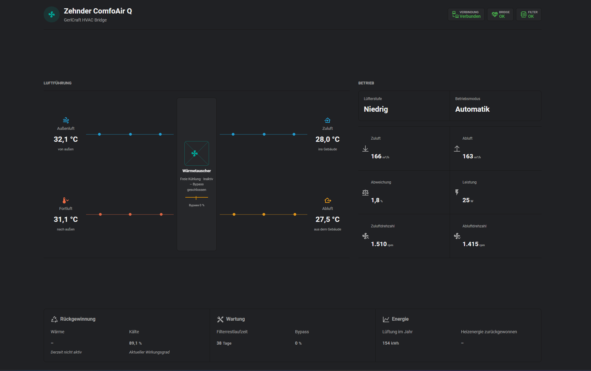

# GerlCraft Zehnder Card

Dieses Verzeichnis enthaelt die Home-Assistant-Custom-Card fuer die Zehnder
ComfoAir Q. Es gibt zwei moegliche Kartentypen:

- **Signature Card v1.5.5**: grosse Anlagenansicht mit ruhigem
  Waermetauscher-Luefter, groesseren Live-Werten, Boost-Bedienung und
  verstaendlicher Filterwarnung.
- **Klassische Card v1.1.3**: kompaktere Anlagenkarte mit animierten
  Luftstroemen, Boost-Bedienung und den bisherigen Messwert-Kacheln.

## Voraussetzung: MQTT zuerst einrichten

**Ohne MQTT-Anbindung funktionieren weder die Messwerte noch die
Steuerelemente dieser Karten.** Vor dem Kopieren der JavaScript-Datei:

1. MQTT-Broker (z. B. Mosquitto) starten und die MQTT-Integration in Home
   Assistant mit diesem Broker verbinden.
2. In der Web-Konfiguration der Bridge denselben Broker mit LAN-IP, Port und
   Zugangsdaten eintragen. Auf `/diagnostics` muss MQTT `Verbunden` anzeigen.
3. In Home Assistant unter der MQTT-Integration das Zehnder-Geraet und seine
   aktuellen Messwerte pruefen. Für Standby Firmware **1.3.0** verwenden.

Die [MQTT-Einrichtung](https://github.com/AshleyVargrand/GerlCraft-Zehnder-Bridge/blob/main/docs/INSTALLATION.md#mqtt-vorbereiten)
beschreibt diese Schritte im Detail. Die Karten verbinden sich nicht direkt
mit der Bridge-IP. Nur eine Kartenressource oder YAML einzufuegen erzeugt
keine Zehnder-Entitaeten. Node-RED und der Bad-Feuchtesensor sind optional.

Beide Karten verwenden die von der Bridge per MQTT Discovery angelegten
Home-Assistant-Entitaeten. Als schreibende Zugriffe sind der auf 60 Minuten
begrenzte Boost, die Luefterstufen 0 bis 3 und die Wahl der Betriebsart
freigegeben. Ab Firmware 1.3.0 zeigt die Betriebsart neben Automatik und
Manuell auch Standby.

## Vorschau



## Welche Variante soll ich nehmen?

Fuer ein neues Dashboard wird die **Signature Card v1.5.5** empfohlen.
Sie ist besser fuer grosse Tablet- oder Wanddisplay-Ansichten lesbar und zeigt
die Filterwarnung direkt verstaendlich an.

Die **klassische Card** ist sinnvoll, wenn du die bisherige Optik behalten
moechtest oder bereits ein Dashboard mit dem alten Kartentyp nutzt.

Wichtig: Wenn beide Varianten parallel installiert werden, muessen sie in
Home Assistant unter unterschiedlichen Dateinamen in `/config/www/` liegen.

## Installation: Klassische Card

1. Die klassische JavaScript-Datei aus diesem Verzeichnis nach Home Assistant
   kopieren:

   ```text
   /config/www/gerlcraft-zehnder-card.js
   ```

2. Home Assistant oeffnen und
   `Einstellungen > Dashboards > Drei-Punkte-Menue > Ressourcen` aufrufen.
3. Eine JavaScript-Modulressource hinzufuegen:

   ```text
   /local/gerlcraft-zehnder-card.js?v=1.1.3
   ```

4. Die Karte im Dashboard so einbinden:

   ```yaml
   type: custom:gerlcraft-zehnder-card
   title: Zehnder ComfoAir Q
   ```

5. Speichern und den Browser einmal vollstaendig neu laden.

## Installation: Signature Card v1.5.5

1. Die Signature-JavaScript-Datei nach Home Assistant kopieren:

   ```text
   /config/www/zehnder_card_v145_final.js
   ```

2. Home Assistant oeffnen und
   `Einstellungen > Dashboards > Drei-Punkte-Menue > Ressourcen` aufrufen.
3. Eine JavaScript-Modulressource hinzufuegen:

   ```text
   /local/zehnder_card_v145_final.js?v=1.5.5
   ```

4. Die Karte im Dashboard so einbinden:

   ```yaml
   type: custom:gerlcraft-zehnder-card-v14
   title: Zehnder ComfoAir Q
   full_height: true
   ```

5. Speichern und den Browser einmal vollstaendig neu laden.

## Vorbereitete Dashboard-Ansicht

Das vorhandene Dashboard kann ueber den Raw-Konfigurationseditor erweitert
werden:

1. Das vorhandene Dashboard oeffnen.
2. Den Raw-Konfigurationseditor oeffnen.
3. Fuer die grosse Signature Card den Inhalt von
   `../view-signature-card.yaml` am Ende der vorhandenen `views:`-Liste
   einfuegen. Fuer die klassische Card stattdessen
   `../view-custom-card.yaml` verwenden.
4. Speichern und den Browser einmal vollstaendig neu laden.

Die empfohlene vorbereitete Ansicht verwendet die Signature Card:

```yaml
type: custom:gerlcraft-zehnder-card-v14
```

Die Signature-Seite erscheint als Reiter `Zehnder` unter dem URL-Pfad
`zehnder-signature`. Die klassische Ansicht verwendet `zehnder-card`.

## Kompakte Darstellung und volle Hoehe ab Version 1.5.5

Die Signature Card verwendet standardmaessig kompaktere Abstaende und
Messwertfelder. Mit `full_height: true` fuellt sie weiterhin die Bildschirmhoehe
wie bisher aus; die untere Infoleiste bleibt am unteren Kartenrand.
Schriftgroessen, Messwerte und Steuerfunktionen bleiben erhalten.

Die beiden Optionen sind unabhaengig voneinander:

```yaml
compact: true
full_height: true
```

Beide Optionen sind standardmaessig aktiv. `compact: false` stellt die
bisherigen grosszuegigen Abstaende wieder her. `full_height: false` begrenzt
die Kartenhoehe auf ihren Inhalt.
Zum Update die JavaScript-Datei ersetzen und die Ressourcen-URL auf
`/local/zehnder_card_v145_final.js?v=1.5.5` setzen, danach vollstaendig neu laden.

## Luftfeuchtigkeit in den Luftstroemen

Signature Card **1.5.4** und klassische Card **1.1.3** zeigen unter jeder
Temperatur die relative Luftfeuchtigkeit mit Tropfensymbol: Aussenluft,
Zuluft, Abluft und Fortluft. Die Werte kommen direkt von den vorhandenen
Zehnder-MQTT-Sensoren. Ein Firmware-Update ist dafuer nicht notwendig.
Ein Klick auf den Feuchtewert oeffnet den Verlauf des jeweiligen Sensors.
Fehlende oder ungueltige Werte werden als `- %` dargestellt.

Zum Aktualisieren die jeweilige JavaScript-Datei in `/config/www/` ersetzen,
die Versionsnummer in der Ressourcen-URL wie oben anpassen und den Browser
vollstaendig neu laden. Kartentyp und vorhandene Dashboard-Konfiguration
bleiben gleich.

Bei abweichenden Entity-IDs koennen die vier Sensoren zugeordnet werden:

```yaml
entities:
  outdoorHumidity: sensor.zehnder_comfoair_q350_aussenluftfeuchtigkeit
  supplyHumidity: sensor.zehnder_comfoair_q350_zuluftfeuchtigkeit
  extractHumidity: sensor.zehnder_comfoair_q350_abluftfeuchtigkeit
  exhaustHumidity: sensor.zehnder_comfoair_q350_fortluftfeuchtigkeit
```

Der optionale Bad-Sensor (`humidity_entity`) bleibt davon unabhaengig.

## Alternative Entity-Praefixe

Die Karte sucht den Entity-Praefix automatisch ueber den
Zuluftvolumenstrom-Sensor. Falls mehrere Zehnder-Bridges vorhanden sind, kann
der gewuenschte Praefix explizit gesetzt werden.

Signature Card:

```yaml
type: custom:gerlcraft-zehnder-card-v14
title: Zehnder ComfoAir Q
entity_prefix: zehnder_comfoair_q350
humidity_entity: sensor.shelly_blu_h_t_zb_luftfeuchtigkeit
humidity_warning_threshold: 65
boost_entity: switch.gerlcraft_zehnder_bridge_boost
boost_remaining_entity: sensor.gerlcraft_zehnder_bridge_boost_restzeit
fan_level_control_entity: select.zehnder_comfoair_q350_lufterstufe_einstellen
ventilation_mode_control_entity: select.zehnder_comfoair_q350_betriebsart_einstellen
full_height: true
```

Klassische Card:

```yaml
type: custom:gerlcraft-zehnder-card
title: Zehnder ComfoAir Q
entity_prefix: zehnder_comfoair_q350
humidity_entity: sensor.shelly_blu_h_t_zb_luftfeuchtigkeit
humidity_warning_threshold: 65
boost_entity: switch.gerlcraft_zehnder_bridge_boost
boost_remaining_entity: sensor.gerlcraft_zehnder_bridge_boost_restzeit
fan_level_control_entity: select.zehnder_comfoair_q350_lufterstufe_einstellen
ventilation_mode_control_entity: select.zehnder_comfoair_q350_betriebsart_einstellen
```

Einzelne Entity-IDs koennen bei Bedarf ebenfalls ueberschrieben werden:

```yaml
type: custom:gerlcraft-zehnder-card-v14
entities:
  supplyFlow: sensor.meine_zuluft
  extractFlow: sensor.meine_abluft
  boost: switch.mein_zehnder_boost
  boostRemaining: sensor.meine_zehnder_boost_restzeit
  fanLevelControl: select.meine_zehnder_lufterstufe
  ventilationModeControl: select.meine_zehnder_betriebsart
```

Fuer die klassische Card wird in diesem Beispiel nur der Kartentyp ersetzt:

```yaml
type: custom:gerlcraft-zehnder-card
```

Ohne Ueberschreibung erkennt die Karte sowohl
`switch.gerlcraft_zehnder_bridge_boost` als auch den praefixbasierten Namen
`switch.zehnder_comfoair_q350_boost`. Der Schalter wird ab Bridge-Firmware
1.1.0 per MQTT Discovery bereitgestellt. Ab Firmware 1.1.1 zeigt die Card die
von der Q350 gemeldete echte Boost-Restzeit an. Mit Firmware 1.1.0 verwendet
sie ersatzweise den bereits vorhandenen Sensor fuer den naechsten Wechsel der
Luefterstufe.

Ab Firmware 1.2.0 wird die Select-Entitaet fuer Abwesend, Niedrig, Mittel und
Hoch sowie eine zweite Select-Entitaet fuer Automatik und Manuell automatisch
angelegt. Die Karten sperren beide Auswahlen waehrend eines aktiven Boosts und
warten nach jeder Auswahl auf die Rueckmeldung der Anlage. Automatik verwendet
eine zeitbegrenzte Stufenwahl. Manuell behält die gewählte Stufe bei, bis
wieder Automatik gewählt wird.

Mit Firmware 1.3.0 ergänzt die Karte den Knopf **Standby**, sobald die
MQTT-Entität diese Betriebsart anbietet. Die Lüfter bleiben stehen, bis
Automatik oder Manuell gewählt oder der separate Standby-Schalter ausgeschaltet
wird.

## Optionaler Feuchtesensor

Die Grundeinrichtung oben funktioniert ohne Feuchtesensor. Nur bei einem
vorhandenen Sensor die folgenden Einstellungen ergaenzen und dessen echte
Entity-ID verwenden.

Ein Feuchtesensor aus Home Assistant kann als zusaetzliches Statusfeld
angezeigt werden. Fuer den Shelly BLU H&T ZB aus dem Node-RED-Beispiel ist
normalerweise diese Konfiguration passend.

Signature Card:

```yaml
type: custom:gerlcraft-zehnder-card-v14
title: Zehnder ComfoAir Q
humidity_entity: sensor.shelly_blu_h_t_zb_luftfeuchtigkeit
humidity_warning_threshold: 65
full_height: true
```

Klassische Card:

```yaml
type: custom:gerlcraft-zehnder-card
title: Zehnder ComfoAir Q
humidity_entity: sensor.shelly_blu_h_t_zb_luftfeuchtigkeit
humidity_warning_threshold: 65
```

Unterhalb der Warnschwelle ist das Feld gruen. Ab der konfigurierten Schwelle
wird es gelb dargestellt. Ist der konfigurierte Sensor nicht erreichbar,
erscheint das Feld rot mit dem Zustand `Offline`.

Die Einbindung des Sensors und der automatische Bad-Boost per Node-RED sind in
[`../node-red/README.md`](../node-red/README.md) beschrieben.

## Filterwarnung

Die Signature Card bewertet zusaetzlich die Filterrestlaufzeit:

```text
> 30 Tage  = OK
<= 30 Tage = Bald faellig
<= 7 Tage  = Dringend
<= 0 Tage  = Faellig
```

Der Filter-Chip oben rechts zeigt die Warnstufe als Text. In der unteren
Filter-Kachel steht der konkrete Grund, zum Beispiel `noch 18 Tage` oder
`jetzt wechseln`.

Die klassische Card zeigt den Filterstatus und die Filterrestlaufzeit, bewertet
die Resttage aber nicht mit dieser erweiterten Warnlogik.

## Aktualisierung

Bei einer neuen Version die JavaScript-Datei ersetzen und die Versionsnummer
in der Ressourcen-URL erhoehen. Danach den Browser neu laden. Die geaenderte
URL verhindert, dass der Browser eine alte Kartenversion aus dem Cache nutzt.

Wenn beide Varianten parallel installiert sind, muss die Versionsnummer nur bei
der Ressource der Karte erhoeht werden, deren Datei ersetzt wurde.
